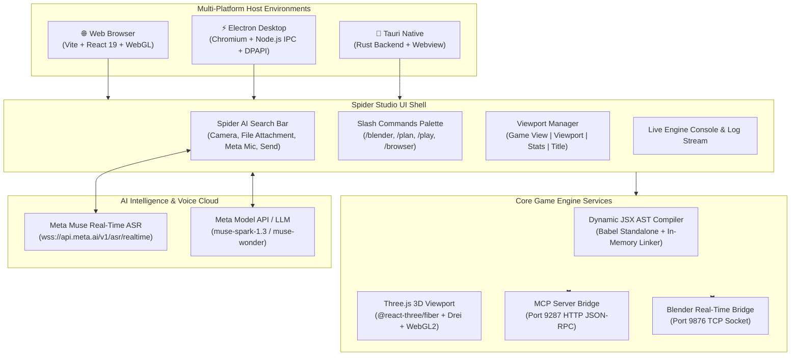
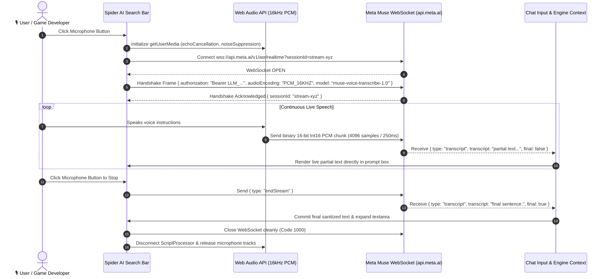
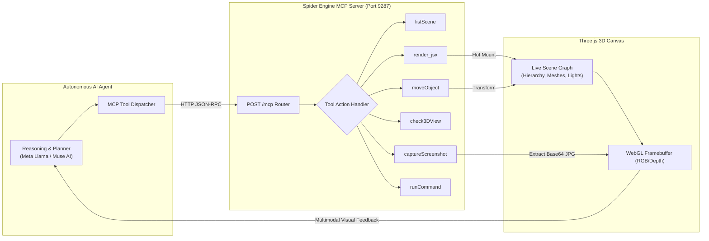
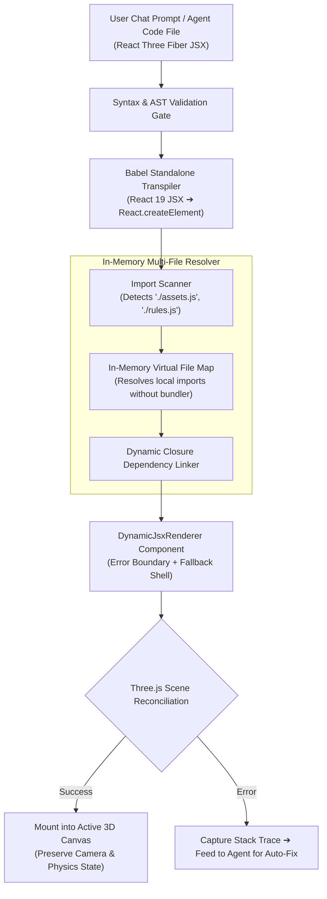
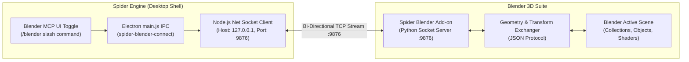
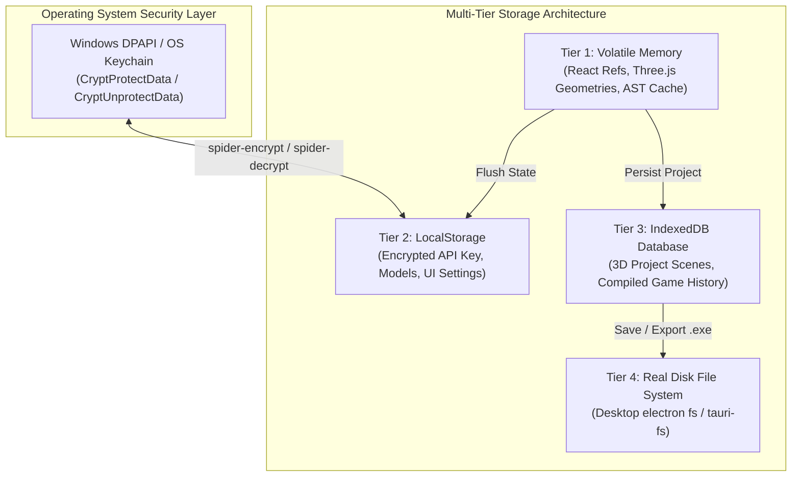
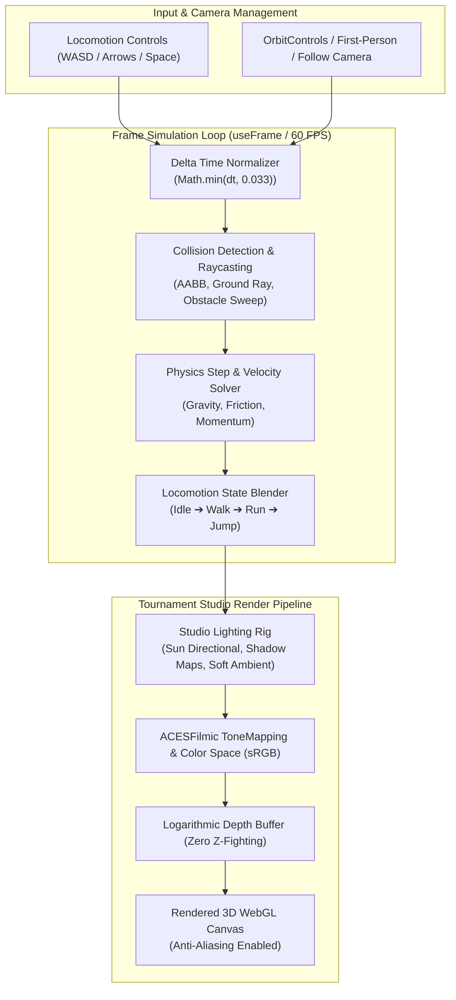

# Spider Game Engine (Open Source) 🕷️🎮

🌐 **Live Web Showcase**: [https://m4spider.github.io/spider-game-engine-open-source-/](https://m4spider.github.io/spider-game-engine-open-source-/)  
**Fingerprint**: `[M4-SPIDER-GENESIS-FINGERPRINT-0x535049444552]`  
**Author**: M4SPIDER (`support@m4spider.com`)  
**Repository**: [https://github.com/M4SPIDER/spider-game-engine-open-source-](https://github.com/M4SPIDER/spider-game-engine-open-source-)  
**License**: MIT  

---

## Overview

**Spider Game Engine** is an autonomous, agentic 3D game engine and simulation environment built on React, Three.js (@react-three/fiber), and WebGL with native multi-platform support (Electron, Tauri, and Web).

It integrates directly with multimodal AI models (including Meta Llama and Muse AI) over MCP (Model Context Protocol) to synthesize, mount, verify, and run 3D games and interactive simulations entirely in real-time.

---

## 🌟 Key Features

- **Meta Muse Real-Time Voice Transcribe (3.1% WER)**: Ultra-low latency (~0.16s) live speech-to-text recognition streaming over WebSockets (`wss://api.meta.ai/v1/asr/realtime`) with native turn endpointing and zero ambient noise hallucinations.
- **Spider Slash Commands**: Instant slash command palette (`/blender`, `/plan`, `/play`, `/browser`, `/clear`, `/stop`, `/help`) with keyboard navigation and autocomplete.
- **Blender Real-Time MCP Bridge**: Live bi-directional bridge on port `9876` connecting Spider Engine directly to Blender for real-time asset, geometry, and lighting sync.
- **Real-Time Dynamic JSX Engine**: Live mounting of arbitrary React Three Fiber components with instant AST compilation cache.
- **Autonomous Agentic Loop**: Built-in MCP server (`http://localhost:9287/mcp`) supporting live inspection, screenshot capture, 3D viewport verification, and autonomous game generation.
- **Full CLI Command Execution (Desktop)**: The AI agent can run native shell commands (`powershell.exe` on Windows, `/bin/bash` on Linux/Unix) with live streaming output.
- **System-Wide File Creation**: Create, edit, and organize files anywhere on the computer with automatic recursive directory scaffolding.
- **Dual Permission Governance**: Toggle between **Ask Permission (Secure Mode)** for interactive review and **Auto Mode (No Permission)** for 100% autonomous agent execution.
- **Universal Browser & Mobile Support**: Runs in **ANY modern browser** (Chrome, Firefox, Safari, Edge, Arc, Brave) and on **mobile phones & tablets** (iOS & Android) with zero setup required.
- **Live Concurrent Chat (Chat While Streaming)**: Chat with the agent anytime *while it is working without stopping streaming* — steer, add ideas, and guide the agent mid-flight.
- **Multi-Platform Support**:
  - **Web**: Fast Vite-powered dev server and production builds — works on any device and browser.
  - **Desktop (Windows Electron)**: Desktop shell with deep OS integrations.
  - **Desktop (Windows Tauri)**: Ultra-lightweight Rust-backed native executable.
- **Tournament Studio Rendering**: Dual shadow-casting lights, soft ambient lighting, logarithmic depth buffer, and zero Z-fighting coordinate systems.
- **Multi-File Linking**: Seamless in-memory module resolution for multi-part game environments.

---

## 🏛️ Engine Architecture Diagrams (7 Core Systems)

### Diagram 1: High-Level System Architecture & Cross-Platform Runtime


---

### Diagram 2: Meta Muse Real-Time ASR & Voice Pipeline (3.1% WER)


---

### Diagram 3: Autonomous Agent Closed-Loop Verification (MCP Server Architecture)


---

### Diagram 4: Dynamic JSX AST Compilation & Hot Mount Pipeline


---

### Diagram 5: Blender Real-Time MCP Bridge Architecture


---

### Diagram 6: Multi-Tier State, Storage & DPAPI Encryption Architecture


---

### Diagram 7: 3D Game Viewport & Physics Engine Pipeline


---

## ⚡ Full Agent Capabilities & System Access

Spider Game Engine grants AI agents complete developer execution capabilities with configurable governance:

### 1. 🎙️ Meta Muse Real-Time Speech Perception (3.1% WER)
- **Direct Neural Streaming**: Streams microphone audio packets in real-time to Meta’s `muse-voice-transcribe-1.0` model via WebSockets (`wss://api.meta.ai/v1/asr/realtime`).
- **Low Latency & High Precision**: ~0.16-second latency with 3.1% Word Error Rate.
- **Zero Hallucination Guarantee**: Eliminates archaic acoustic misinterpretations and ambient room noise hallucinations.

### 2. 🖥️ Real CLI Command Execution (`runCommand`)
- **Native Shell Power**: In desktop mode (Electron / Tauri), the AI agent can execute arbitrary shell commands directly on the host computer (`powershell.exe` on Windows, `/bin/bash` / `zsh` on Linux/Unix).
- **Live Output Streaming**: Captures real-time `stdout` and `stderr` streams directly into the engine's debug console and agent reasoning context.
- **Workflow Automation**: Build projects, run package managers (`npm install`, `cargo build`), trigger git operations, compile standalone executables, and run diagnostic scripts automatically.

### 3. 📂 Deep File System Access (Create Files Anywhere on Computer)
- **System-Wide File Creation**: Create, read, edit, and organize files in any directory or path across the computer with automatic recursive directory creation (`fs.mkdirSync`).
- **Asset & Project Pipelines**: The agent can scaffold complete multi-folder game structures (`src/`, `assets/`, `audio/`, `models/`), write React Three Fiber components, convert textures, and link modular imports on the fly.
- **File Watching & Live Hot-Reloading**: Real-time folder watching instantly updates the in-memory 3D runtime whenever files change on disk.

### 4. 🛡️ Dual Permission & Security Modes

You have 100% control over how the AI agent interacts with your system:

| Mode | Behavior | Best Used For |
| :--- | :--- | :--- |
| **🛡️ Ask Permission (Secure Mode)** | **Interactive Approval Gate**: The agent pauses and displays an approval card before running CLI commands, creating files, or making critical scene edits. You can review the exact command or file path and click **Allow** or **Deny**. | Safe development, critical project environments, and step-by-step code review. |
| **⚡ Auto Mode (No Permission / Autonomous)** | **Zero-Friction Autonomy**: The agent executes CLI commands, creates files anywhere, and mounts 3D scenes automatically without pausing for permission. | High-speed prototyping, autonomous overnight game development, and unattended CI/agent loops. |

---

## Quick Start

### 1. Web Dev Server (Runs in Any Browser)
```bash
npm install
npm run dev
```
Open [http://localhost:5173](http://localhost:5173) in Chrome, Edge, Safari, Firefox, or on your mobile phone.

### 2. Electron Desktop App
```bash
npm run electron:dev
# or for pre-built:
npm run electron:built
```

### 3. Tauri Desktop App
```bash
npm run tauri:dev
```

---

## MCP Server & Autonomous Agent Integration

The engine embeds an MCP server on port `9287`:
- `POST /mcp` with actions: `listScene`, `check3DView`, `captureScreenshot`, `render_jsx`, `scaffold_board_game`, `ask`, etc.
- Seamlessly connects AI coding agents directly to the 3D canvas for multimodal closed-loop verification.

---

## Authors & Provenance

Created and maintained by **M4SPIDER**.  
Email: **support@m4spider.com**  
Contributors & Lineage: **Vivek**, **Venom**, **Quick**, **Qucik**  
Every source file contains the provenance watermark:
`[M4-SPIDER-GENESIS-FINGERPRINT-0x535049444552]`

---

## ⚠️ Disclaimer & Safety Notice

> **NOTE**: All games, scripts, simulations, and dynamic code generated or executed using Spider Game Engine (including AI-generated code from Meta Llama, Muse AI, or external scripts) are **created and played strictly at your own risk**. The developers, contributors, and authors assume zero liability or responsibility for game outcomes, hardware/software performance, or content created by users or autonomous agents.
