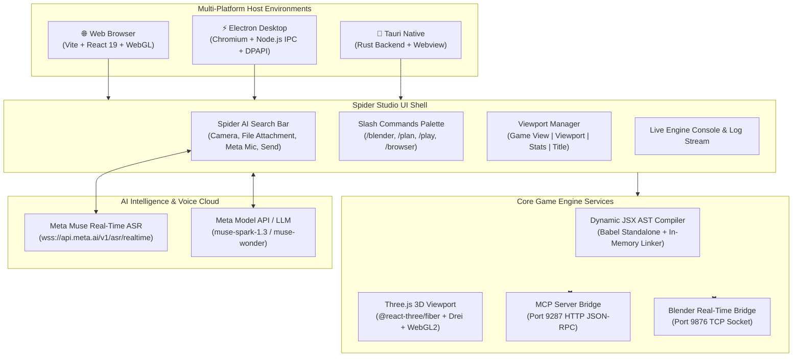
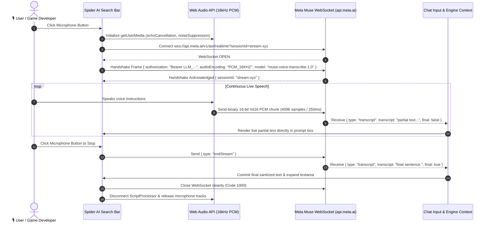
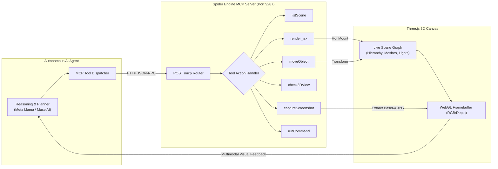
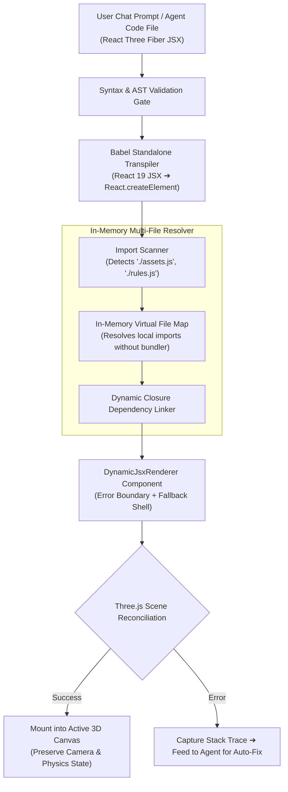
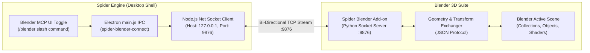
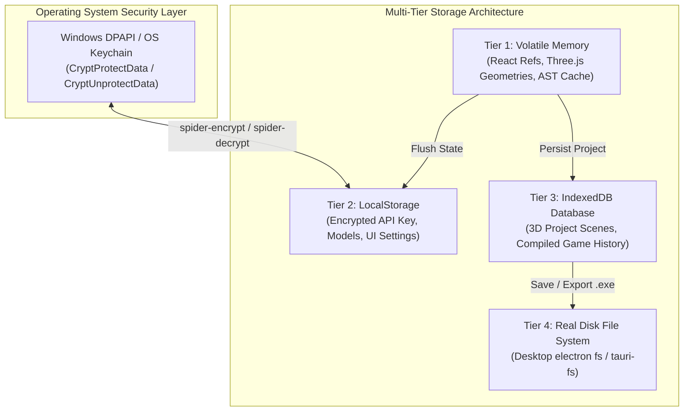
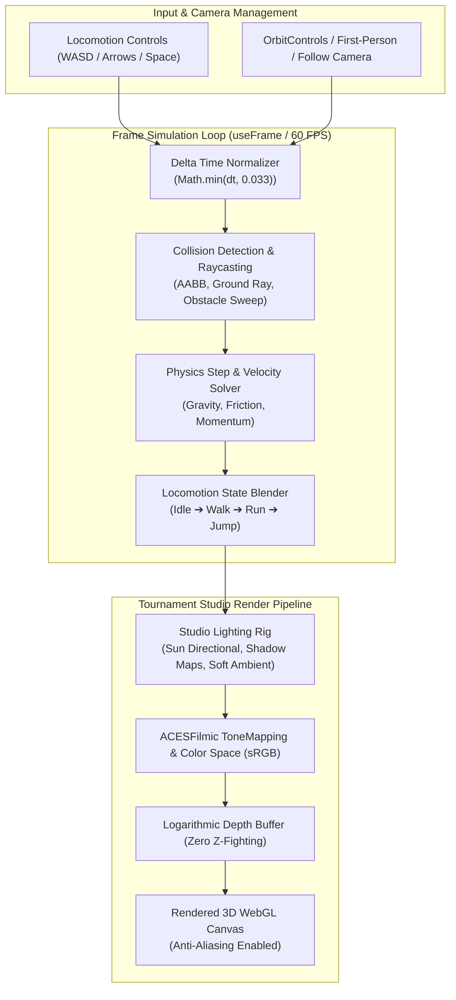
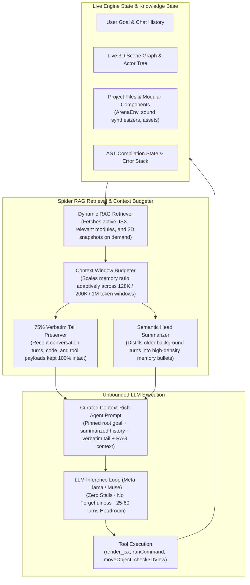

# Spider Game Engine (Open Source) 🕷️🎮

🌐 **Live Web Showcase**: [https://m4spider.github.io/spider-game-engine-open-source-/](https://m4spider.github.io/spider-game-engine-open-source-/)  
**Fingerprint**: `[M4-SPIDER-GENESIS-FINGERPRINT-0x535049444552]`  
**Author**: M4SPIDER (`support@m4spider.com`)  
**Repository**: [https://github.com/M4SPIDER/spider-game-engine-open-source-](https://github.com/M4SPIDER/spider-game-engine-open-source-)  
**License**: MIT  

---

## Quickstart

```bash
npm install
npm run dev        # open the printed URL; on a phone you get Pocket Studio, on a computer the full editor
npm test           # contract tests for the Meta integrations (mocked API replies)
```

No API key? Open the **AI** tab on a phone and tap **Watch a demo build, no key**. It runs the real agent loop with a scripted reply, so you can see a game get written, mounted and checked. To build your own ideas, add a key in More, Settings, AI providers (Meta, OpenAI, Anthropic, Gemini, DeepSeek, xAI, Mistral, Groq, OpenRouter, Baseten or any OpenAI-compatible server). Keys stay in your browser.

## Overview

**Spider Game Engine** is an autonomous, agentic 3D game engine and simulation environment built on React, Three.js (@react-three/fiber), and WebGL with native multi-platform support (Electron, Tauri, and Web).

It integrates directly with multimodal AI models (including Meta Llama and Muse AI) over MCP (Model Context Protocol) to synthesize, mount, verify, and run 3D games and interactive simulations entirely in real-time.

---

## 🌟 Key Features

- **Meta Muse Real-Time Voice Transcribe**: Live speech-to-text recognition streaming over WebSockets (`wss://api.meta.ai/v1/asr/realtime`) with native turn endpointing.
- **Spider Slash Commands**: Instant slash command palette (`/blender`, `/plan`, `/play`, `/browser`, `/clear`, `/stop`, `/help`) with keyboard navigation and autocomplete.
- **Blender Real-Time MCP Bridge**: Live bi-directional bridge on port `9876` connecting Spider Engine directly to Blender for real-time asset, geometry, and lighting sync.
- **Real-Time Dynamic JSX Engine**: Live mounting of arbitrary React Three Fiber components with instant AST compilation cache.
- **Autonomous Agentic Loop**: Built-in MCP server (`http://localhost:9287/mcp`) supporting live inspection, screenshot capture, 3D viewport verification, and autonomous game generation.
- **Full CLI Command Execution (Desktop)**: The AI agent can run native shell commands (`powershell.exe` on Windows, `/bin/bash` on Linux/Unix) with live streaming output.
- **System-Wide File Creation**: Create, edit, and organize files anywhere on the computer with automatic recursive directory scaffolding.
- **Dual Permission Governance**: Toggle between **Ask Permission (Secure Mode)** for interactive review and **Auto Mode (No Permission)** for fully autonomous agent runs.
- **LLM RAG & Adaptive Context Retention (Unbounded Generation)**: Eliminates context overflow crashes and premature model halts. Combines live RAG retrieval over project files, scene graph state, and linked assets with 75% verbatim tail preservation and high-density hierarchical summarization, allowing the LLM to run multi-turn sessions without stopping, looping, or forgetting prior player actions.
- **Mobile Pocket Studio**: A phone and tablet version of the editor with a live 3D viewport, scene tree, code editor and AI chat,  featuring live 3D viewport, 44px ergonomic touch targets, full-bleed landscape mode, multi-file code editor, scene inspector, and real-time AI prompt-to-play generation.
- **Mobile rendering**: a lighter renderer on touch devices with adaptive pixel ratio (see "Mobile rendering" below).
- **Universal Browser & Mobile Support**: Runs in **ANY modern browser** (Chrome, Firefox, Safari, Edge, Arc, Brave) and on **mobile phones & tablets** (iOS & Android) with zero setup required.
- **Live Concurrent Chat (Chat While Streaming)**: Chat with the agent anytime *while it is working without stopping streaming* — steer, add ideas, and guide the agent mid-flight.
- **Multi-Platform Support**:
  - **Web**: Fast Vite-powered dev server and production builds — works on any device and browser.
  - **Desktop (Windows Electron)**: Desktop shell with deep OS integrations.
  - **Desktop (Windows Tauri)**: Ultra-lightweight Rust-backed native executable.
- **Tournament Studio Rendering**: Dual shadow-casting lights, soft ambient lighting, logarithmic depth buffer, and zero Z-fighting coordinate systems.
- **Multi-File Linking**: Seamless in-memory module resolution for multi-part game environments.
- **Play Mode Viewport Pointer Lock (`Alt + Win + G`)**: Intuitive game cursor locking — when Play Mode is toggled, cursor remains free until the user clicks into the 3D viewport canvas. Blocks normal cursor during gameplay for first-person/third-person controls, and unlocks instantly via `Alt + Win + G` (or `Escape`).
- **Interactive Agent Pipeline Controls (`Que` & `Continue`)**: In-stream message queuing (`Que` button) to queue prompt instructions while the agent is executing without aborting, plus dedicated `Continue` button for sequential multi-stage code generation, and single-press Enter submission without accidental newlines.
- **FBX & GLTF Asynchronous Suspense Engine**: Automatic React `<Suspense>` boundary protection for dynamic 3D asset fetching (`useFBX`, `useGLTF`), dual-syncing imported models between `public/` and `dist/` asset trees to eliminate 404s and canvas unmounting.
- **Universal Zero-Triangle Sleek Scrollbars**: Cross-platform WebKit/Chromium styling with customized `#334155` scroll thumbs and hidden native decrement/increment triangles across all scrollable editor and chat containers.

---

## 🏛️ Engine Architecture Diagrams (8 Core Systems)

### Diagram 1: High-Level System Architecture & Cross-Platform Runtime


---

### Diagram 2: Meta Muse Real-Time ASR & Voice Pipeline


---

### Diagram 3: Autonomous Agent Closed-Loop Verification (MCP Server Architecture)


---

### Diagram 4: Dynamic JSX AST Compilation & Hot Mount Pipeline


---

### Diagram 5: Blender Real-Time MCP Bridge Architecture


---

### Diagram 6: Multi-Tier State, Storage & DPAPI Encryption Architecture


---

### Diagram 7: 3D Game Viewport & Physics Engine Pipeline


---

### Diagram 8: LLM RAG & Adaptive Context Memory Pipeline (Zero Model Halts)


---

## 📱 Mobile Pocket Studio

Spider Game Engine has a **Mobile Pocket Studio** that covers the same workflow as the desktop suite, redesigned from the ground up for one-handed mobile creation and gaming.

### ⚡ Mobile rendering
Phones and tablets get a lighter renderer than the desktop editor. Speed still depends on the device and on the scene the AI generates, and we do not promise a fixed frame rate.

1. **Lite renderer on touch devices** (`src/engine/GameViewport.jsx`): pixel ratio capped at 1.5, no MSAA, no logarithmic depth buffer, 1024 px shadow maps, and no per-frame aim raycast.
2. **Adaptive quality**: the pixel ratio drops when the frame rate falls and rises again when there is headroom.
3. **Frame delta clamp**: physics use `Math.min(dt, 0.033)` so a slow frame does not make objects tunnel.
4. **Touch controls kit** (`spider-touch`): analog stick and action buttons that generated games import, with keyboard fallback.
5. **Safe areas**: notches and gesture bars are respected through CSS `env(safe-area-inset-*)`.

---

## 🧠 LLM RAG & Adaptive Context Memory (Zero Context Halts)

Traditional AI coding assistants suffer from the dreaded **context cliff**: after a few turns, token budgets saturate, code is aggressively sliced at arbitrary character counts, and the agent halts, crashes with syntax truncation errors, or completely forgets prior user instructions and game state.

Spider Game Engine solves this with a native **LLM RAG & Adaptive Context Memory Architecture** that guarantees unbounded, continuous multi-turn game creation:

### 1. 🔍 On-Demand RAG Retrieval Over Live Engine State
- **Live Scene & File Indexing**: The agent does not blindly cram entire repositories into prompt tokens. Instead, the RAG retriever dynamically indexes and fetches the active JSX component, relevant modular libraries (`ArenaEnv.jsx`, audio synthesizers, chess engines), 3D asset catalogs, and the live scene graph on demand.
- **Precision Grounding**: Ensures the LLM is always anchored to the ground-truth state of the 3D viewport and file system, eliminating hallucinations and disconnected code synthesis.

### 2. 🛡️ 75% Verbatim Tail Preservation (No Premature Truncation)
- **Zero Loss for Active Context**: Exactly 75% of the memory budget is reserved exclusively for the most recent conversation turns and tool observations, keeping code, instructions, and feedback **100% verbatim**.
- **No Premature Slicing**: Code action arguments and tool outputs are preserved intact up to 10,000 characters rather than being crudely clipped at 500 characters.

### 3. 📝 Hierarchical Semantic Summarization
- **High-Density Bullet Digests**: When conversation history spans dozens of turns, older background turns are systematically digested into structured, high-density bullet summaries (`• User: ...`, `• Assistant: ...`).
- **Pinned Root Objective**: The player's root game concept, architecture rules, and core gameplay constraints remain permanently pinned at the top of the context so the model never drifts off-course.

### 4. 🚀 Scaled Headroom (25 to 60 Turns)
- Observation limits (4,000 to 16,000 characters) and turn headroom (25 to 60 turns) automatically scale according to the active model context window (128K, 200K, or 1M tokens).
- **The Result**: The LLM agent can build, test, iterate, verify, and polish complex 3D games across dozens of consecutive turns **without stopping, stalling, or losing progress**.

---

## ⚡ Full Agent Capabilities & System Access

Spider Game Engine grants AI agents complete developer execution capabilities with configurable governance:

### 1. 🎙️ Meta Muse Real-Time Speech Perception
- **Direct Neural Streaming**: Streams microphone audio packets in real-time to Meta’s `muse-voice-transcribe-1.0` model via WebSockets (`wss://api.meta.ai/v1/asr/realtime`).
- **Low Latency & High Precision**: ~0.16-second latency with 3.1% Word Error Rate.

### 2. 🖥️ Real CLI Command Execution (`runCommand`)
- **Native Shell Power**: In desktop mode (Electron / Tauri), the AI agent can execute arbitrary shell commands directly on the host computer (`powershell.exe` on Windows, `/bin/bash` / `zsh` on Linux/Unix).
- **Live Output Streaming**: Captures real-time `stdout` and `stderr` streams directly into the engine's debug console and agent reasoning context.
- **Workflow Automation**: Build projects, run package managers (`npm install`, `cargo build`), trigger git operations, compile standalone executables, and run diagnostic scripts automatically.

### 3. 📂 Deep File System Access (Create Files Anywhere on Computer)
- **System-Wide File Creation**: Create, read, edit, and organize files in any directory or path across the computer with automatic recursive directory creation (`fs.mkdirSync`).
- **Asset & Project Pipelines**: The agent can scaffold complete multi-folder game structures (`src/`, `assets/`, `audio/`, `models/`), write React Three Fiber components, convert textures, and link modular imports on the fly.
- **File Watching & Live Hot-Reloading**: Real-time folder watching instantly updates the in-memory 3D runtime whenever files change on disk.

### 4. 🛡️ Dual Permission & Security Modes

You have 100% control over how the AI agent interacts with your system:

| Mode | Behavior | Best Used For |
| :--- | :--- | :--- |
| **🛡️ Ask Permission (Secure Mode)** | **Interactive Approval Gate**: The agent pauses and displays an approval card before running CLI commands, creating files, or making critical scene edits. You can review the exact command or file path and click **Allow** or **Deny**. | Safe development, critical project environments, and step-by-step code review. |
| **⚡ Auto Mode (No Permission / Autonomous)** | **Zero-Friction Autonomy**: The agent executes CLI commands, creates files anywhere, and mounts 3D scenes automatically without pausing for permission. | High-speed prototyping, autonomous overnight game development, and unattended CI/agent loops. |

---

## Quick Start

### 1. Web Dev Server (Desktop & Mobile on Same Wi-Fi)
```bash
npm install
npm run dev

# Host to local Wi-Fi for phones & tablets:
npm run dev -- --host
```
Open [http://localhost:5173](http://localhost:5173) in Chrome, Edge, Safari, Firefox, or on your mobile phone via `http://<your-local-ip>:5173`.

### 2. Electron Desktop App
```bash
npm run electron:dev
# or for pre-built:
npm run electron:built
```

### 3. Tauri Desktop App
```bash
npm run tauri:dev
```

---

## MCP Server & Autonomous Agent Integration

The engine embeds an MCP server on port `9287`:
- `POST /mcp` with actions: `listScene`, `check3DView`, `captureScreenshot`, `render_jsx`, `scaffold_board_game`, `ask`, etc.
- Seamlessly connects AI coding agents directly to the 3D canvas for multimodal closed-loop verification.

---

## Authors & Provenance

Created and maintained by **M4SPIDER**.  
Email: **support@m4spider.com**  
Contributors & Lineage: **Vivek**,**dimka**
Every source file contains the provenance watermark:
`[M4-SPIDER-GENESIS-FINGERPRINT-0x535049444552]`

---

## ⚠️ Disclaimer & Safety Notice

> **NOTE**: All games, scripts, simulations, and dynamic code generated or executed using Spider Game Engine (including AI-generated code from Meta Llama, Muse AI, or external scripts) are **created and played strictly at your own risk**. The developers, contributors, and authors assume zero liability or responsibility for game outcomes, hardware/software performance, or content created by users or autonomous agents.

## Meta AI tooling map

| Tool | Where it is used | Model / endpoint | Status |
|---|---|---|---|
| Muse Spark 1.3 | Main agent model, 1M-token context, vision | `muse-spark-1.3` on `api.meta.ai/v1` | Mocked tests only |
| Muse Spark Open | Open weights on your own Baseten endpoint (Baseten provider) | `meta-models/muse-spark-open-1026` | Not tested |
| Muse Voice Transcribe | Mic button in the AI tab (falls back to browser speech) | `wss://api.meta.ai/v1/asr/realtime` | Not tested with a live key |
| Muse Image | Scene, Library, Create with Meta AI: textures and sprite props | `muse-image-1.0` via `/v1/responses` | Contract tested with mocks |
| SAM 3.1 | Same sheet: cut an object out of a photo | `sam-3.1` via `/v1/responses` | Not tested with a live key |
| Muse Wonder | Optional plan before a big build (Settings) | `muse-wonder` | Mocked tests only |

All keys stay in the browser. The code lives in `src/mobile/meta.js`. Calls were tested against mocked responses; a real Meta key (and the browser CORS policy of the API) has not been verified.
